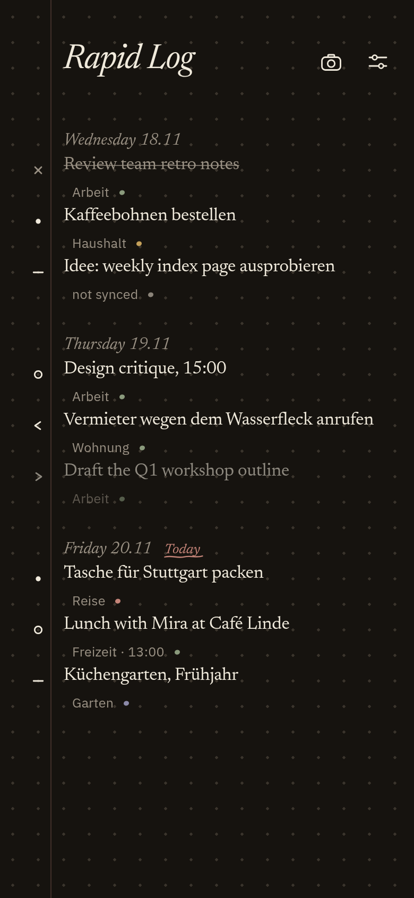
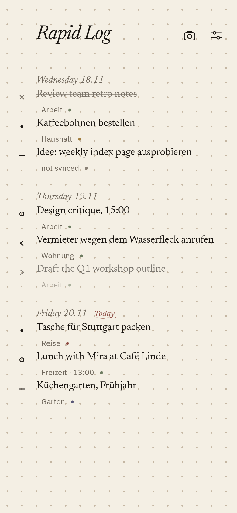
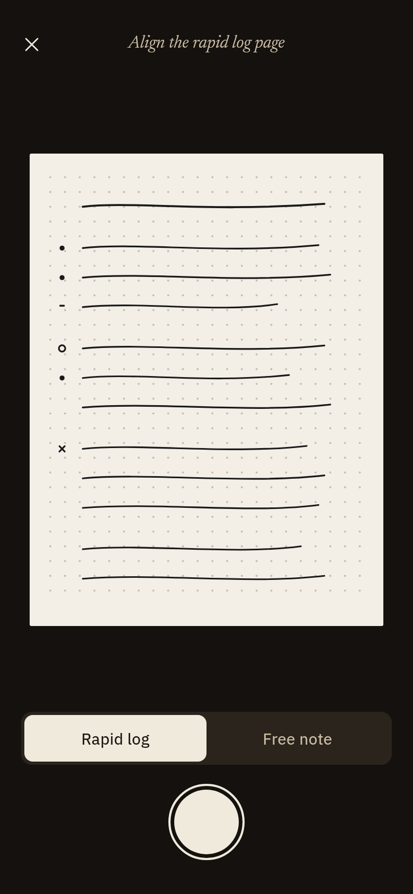
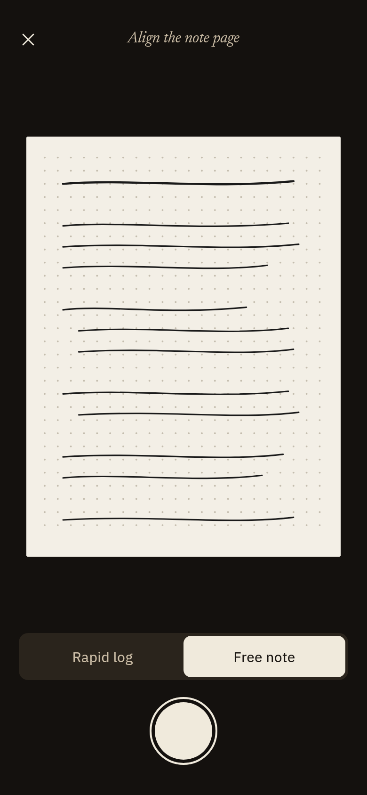
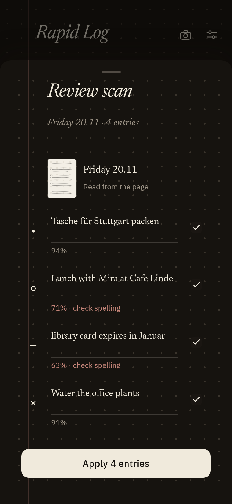
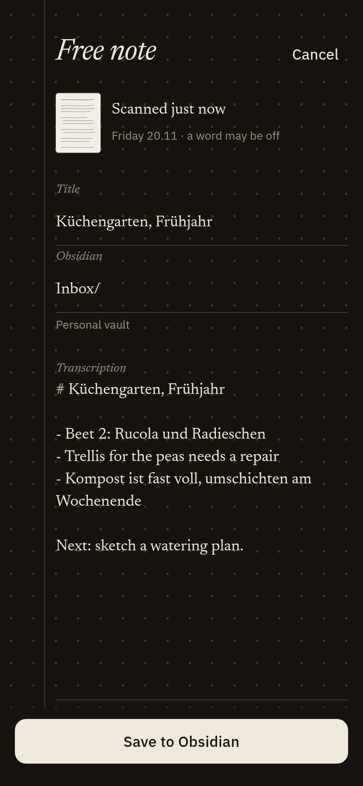
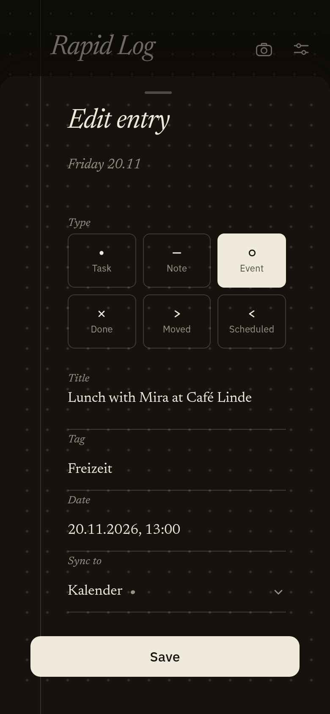

# bujo product brief

## What it is

A companion app for a paper bullet-journal rapid log. The notebook stays the daily writing surface. The app holds a digital copy of that log: you scan a page, review what was recognized, and keep the entries on the phone, grouped by day.

The main view is the rapid log, under headings like `Wednesday 18.11`, in the paper design below. It is not a backlog-first task manager.

## Requirements

From the pages he marked up:

- **R1.** The main view is the daily / rapid log.
- **R2.** Every bujo type is first-class: `•` task, `–` note, `○` event, `x` done, `>` migrated, `<` scheduled. Each entry shows a type symbol, a title, and a tag plus sync status.
- **R3.** An OCR scanner for rapid-log pages: photograph a page, read the bullets, and review them before they are applied.
- **R4.** Tasks and events sync to Nextcloud via CalDAV (other providers later). There is no sync idea for notes yet.
- **R5.** Free-form note scanning: photograph a note, OCR it to editable markdown, and sync it to Obsidian.

## Design

A paper notebook: dotted grid, entries snapped to the 24px grid, warm beige light mode (`#f4efe4`), dark default. Serif text (Newsreader) for titles, dates and entries; inked SVG symbols for the six bullets; IBM Plex Sans for meta and chrome. Sync is a muted ink mark (sage Nextcloud, ochre pending, brick conflict, indigo Obsidian, ink gray not synced), not a traffic-light pill.

Mock screens (dark default, plus the light log):

## Data model

Entries live in the app's own database. An entry has a date, a type, a title, a tag, and a sync state. This replaces the previous "Nextcloud is the source of truth" model, where the app was a view over VTODO lists.

Sync is a side effect, not the store:

- **Tasks** (`•`, `x`, `>`, `<`) bind to VTODO in **Aufgaben** (personal) or **Arbeit** (work). Until live sync is okayed, writes go only to the test list `bujo-test`. Never to Aufgaben or Arbeit, and never to a real list without a yes.
- **Events** (`○`) bind to VEVENT in a Nextcloud calendar. That calendar is run by the calendar bot, so conventions (which calendar, how titles, times and identities are written) are agreed with it before any writes.
- **Notes** (`–`) stay local in the app DB. There is no Nextcloud mapping yet.
- **Free notes** (R5) go to Obsidian, vault **Obsi**, owned by the obsi bot. The mechanism is still open: a Nextcloud WebDAV folder the vault already syncs, the Obsidian Local REST API, or git.

CalDAV write rules that still apply once a bind exists: fresh UID per new item, `PUT` with `If-None-Match: *` on create, preserve unknown properties on edit, read back after every write, no item or collection deletes without a yes. Tests never touch the real lists.

### Task mapping (when live)

- `•` open task → `STATUS:NEEDS-ACTION`.
- `x` done → `STATUS:COMPLETED`, plus `COMPLETED` and `PERCENT-COMPLETE:100`.
- `<` scheduled → an open task with a `DUE` date, written `DUE;VALUE=DATE:YYYYMMDD`. Do not write `DTSTART`.
- `>` migrated → keep or create the VTODO in the backlog; do not treat it as done. Prefer matching an existing item over a duplicate.
- Tags go in `CATEGORIES`, created freely, no preset list.

Matching a scanned line to an existing VTODO still prefers a stored UID, then a fuzzy title match (German text, OCR noise). Weak or ambiguous matches stay unmatched until the review decides.

## What carries over

- **Auth.** Full app-kit auth, the single account, recovery code, email via Resend, sessions, and hashed agent tokens created in Settings.
- **Scan pipeline / OCR service.** The self-hosted `ocr/` container (`OCR_URL`), in-memory photo upload, mandatory review before any apply. The symbol detector (OpenCV) plus TrOCR small handwritten, with Tesseract as fallback. Real page photos stay out of git and are not written to disk.
- **CalDAV client.** The existing client and write/read-back discipline, pointed at `bujo-test` until live lists are okayed, and later at events only after the calendar-bot conventions are agreed.
- **Agent API / MCP.** Versioned `/api/v1` and the streamable-HTTP MCP server, with the same bearer tokens. These need to grow from "tasks in Nextcloud" to "entries in the app DB, plus sync". Scan apply stays a signed-in-session action unless he later changes that. No deletes without a yes.

The stack stays an app-kit v0.7.0 PWA, `node:sqlite`, deploy on Hetzner via the hetzner ops agent, Tailscale as the network layer.

## What changes

- The main surface is the rapid log, not the backlog filters.
- The app database is the source of truth for entries. Nextcloud and Obsidian are sync targets.
- Events are in scope (VEVENT), which the old brief treated as off-limits.
- Free-form notes and an Obsidian target are in scope.
- The UI follows the paper design above, with dark as the default and a warm paper light mode, rather than only app-kit system tokens.

## v1

**In**

- Rapid log as the main view, paper design, dark default and light paper, all six entry types, tag and sync status.
- Rapid-log scan with a mandatory per-line review, then apply into the app DB.
- Free-note scan, editable markdown, save to Obsidian once a mechanism is chosen.
- Local entry database.
- CalDAV sync for tasks to `bujo-test`. Live Aufgaben / Arbeit only after a yes. Event writes only after calendar-bot conventions are agreed.
- Existing auth, OCR service, CalDAV client, and agent API/MCP, extended for the new model.

**Out**

- Replacing or transcribing the whole notebook, or printing back onto paper.
- Live writes to Aufgaben, Arbeit, or any real calendar until those are okayed.
- A second task database alongside the entry DB, or treating Nextcloud as the source of truth again.
- Note sync to Nextcloud (still no idea).
- Multi-user or public access, a CLI, or third-party OCR as the first choice.
- Deleting items or collections without a yes.

## Open questions

- **Event calendar.** Which calendar receives VEVENTs, and what conventions does the calendar bot need before bujo writes anything.
- **Obsidian.** WebDAV folder vs Local REST API vs git, and which folder in the Obsi vault (the mock used `Inbox/`).
- **Backlog view.** Whether, and how, the existing tag / priority / someday / scheduled backlog is migrated now that the rapid log is the main view.
- **Notes.** Whether `–` notes ever sync, and to where, if a later idea appears.
- **Umlaut OCR.** German umlauts and handwriting remain a weak point of the current recognizer; the review has to catch them, and the engine may need another pass with more real pages.

## Auth, stack, and deploy

Shape follows Hangry (free-now) and pins **app-kit v0.7.0**. Vendor it with `scripts/sync.sh` into `public/app-kit` and `src/app-kit`. Each tree has a `VERSION` file, is committed, and is never edited locally.

- `head.html` snippet, `ak-tokens` accent, `ak-sw.js` and `scripts/manifest.mjs`. Skip `ak-view-transitions.css`.
- Light and dark are required. Dark is the default; light is the warm paper theme, not a bright white system sheet.
- `server/auth.ts`: full app-kit auth over the local `node:sqlite` store (`users`, `sessions`, `auth_links`), plus hashed agent tokens in that same store.
- Email is mandatory, sent with Resend (`RESEND_API_KEY`, `MAIL_FROM`).
- This is a single-user app, but it uses full app-kit auth, not Tailscale-only access. Tailscale is how the app is reached, not a substitute for login.
- Deploy on Hetzner, via the hetzner ops agent.
